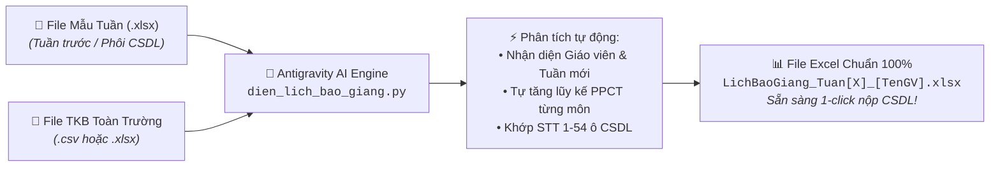

# Kỹ năng Antigravity: Tự Động Điền Bảng Mẫu Lịch Báo Giảng Tuần

> **Quy tắc 2 Tệp Tối Giản:** Giáo viên chỉ cần cung cấp đúng **2 tệp duy nhất**:
> 1. **1 File Mẫu Tuần (`.xlsx`)**: File tải từ CSDL hoặc file lịch tuần trước của chính thầy/cô (hỗ trợ cả phôi rỗng tải mới).
> 2. **1 File TKB Toàn Trường (`.csv` hoặc `.xlsx`)**: File thời khóa biểu chung do nhà trường/BGH xuất ra.
>
> 🚀 **Mọi tác vụ còn lại:** Robot AI Antigravity tự động phân tích giáo viên, bóc tách TKB, tính lũy kế PPCT và tạo file Excel chuẩn 100% chỉ trong 3 giây!

---

## 🎯 CƠ CHẾ KÍCH HOẠT:
Kỹ năng này tự động kích hoạt khi:
- Người dùng tải lên/cung cấp 2 file (file mẫu tuần và file TKB toàn trường).
- Người dùng nói:
  - *"Điền lịch báo giảng tuần [X] cho tôi"*
  - *"Lên lịch báo giảng tuần tiếp theo từ 2 file này"*
  - *"Tạo lịch báo giảng tuần cho giáo viên [Tên GV]"*
  - *"Tự động điền lịch báo giảng"*

---

## 🧭 1. NGUYÊN TẮC HOẠT ĐỘNG CỦA ROBOT AI (PIPELINE)



---

## 🛠️ 2. LỆNH THỰC THI CHUẨN TRONG ANTIGRAVITY

Khi nhận được yêu cầu, Agent chạy ngay lệnh tự động hóa:

```powershell
python "e:\csdl đồng Nai\scripts\dien_lich_bao_giang.py" `
  --template "E:\csdl đồng Nai\Lich_Bao_Giang\Nông Văn Hùng (7023564959) (7).xlsx" `
  --tkb "E:\csdl đồng Nai\Lich_Bao_Giang\TKB_Toan_Truong_Moi_16_11_2026.csv" `
  --week <số_tuần_cần_làm> `
  --teacher "<họ_và_tên_giáo_viên>"
```

*(Lưu ý: Nếu không truyền `--week` và `--teacher`, script sẽ tự động trích xuất Tên GV từ ô A1 và tự động lấy Tuần tiếp theo = Tuần cũ + 1).*

---

## 📋 3. CÁC QUY CHUẨN KỸ THUẬT BẮT BUỘC

1. **Chuẩn hóa danh mục môn học:**
   - `HĐTN-HN`, `Hoạt động trải nghiệm` ➔ `HĐTN`
   - `Công nghệ (T...)` ➔ `Công nghệ`
   - `Vật lý (KHTN)`, `Hóa học`, `Sinh học` ➔ chuẩn phân môn hoặc môn tích hợp theo CSDL.
2. **Quy tắc tính lũy kế PPCT:**
   - **Trường hợp 1 (Có lịch tuần cũ):** Quét toàn bộ các tiết dạy trong tuần cũ để lấy số tiết PPCT lớn nhất của từng cặp `(Môn, Lớp)`. Sang tuần mới, số tiết tăng dần: `mốc_cũ + 1`, `mốc_cũ + 2`...
   - **Trường hợp 2 (Phôi rỗng tải mới từ CSDL):**
     + Thầy Nông Văn Hùng (mốc hiệu chỉnh chuẩn Tuần 11): CN8 = 11, CN9 = 21/22, HĐTN = 31/32/33. Tuần mới tính theo độ lệch tuần tương ứng.
     + Giáo viên khác: Tự động tính số tiết/tuần $k$ từ TKB và tính mốc tuần mới $= (W - 1) \times k + 1 \dots W \times k$.
3. **Quy tắc 54 ô biểu mẫu CSDL Giáo dục:**
   - Mỗi ngày gồm 9 tiết: 5 tiết Sáng (tiết 1-5) + 4 tiết Chiều (tiết 1-4).
   - STT được tính theo công thức:
     - Sáng: `(Thứ - 2) * 9 + Tiết`
     - Chiều: `(Thứ - 2) * 9 + 5 + Tiết`
   - Các ô trống (không có tiết dạy) phải được xóa sạch dữ liệu cũ.
4. **Bật ngay File Explorer sau khi hoàn thành:**
   - Luôn chạy lệnh `explorer.exe "E:\csdl đồng Nai\Lich_Bao_Giang"` để hiển thị file cho giáo viên.

---

## 🖼️ 4. HÌNH ẢNH HƯỚNG DẪN INFOGRAPHIC

Xem hình ảnh hướng dẫn trực quan:
- File ảnh đồ họa độ phân giải cao: `infographic_huong_dan_lbg.png`
- File web trực quan tương tác: `infographic_huong_dan_lbg.html`

---

*Bản quyền: © 2026 Thầy Nông Văn Hùng & Cộng đồng AI Giáo dục Đồng Nai 🌻☀️.*
